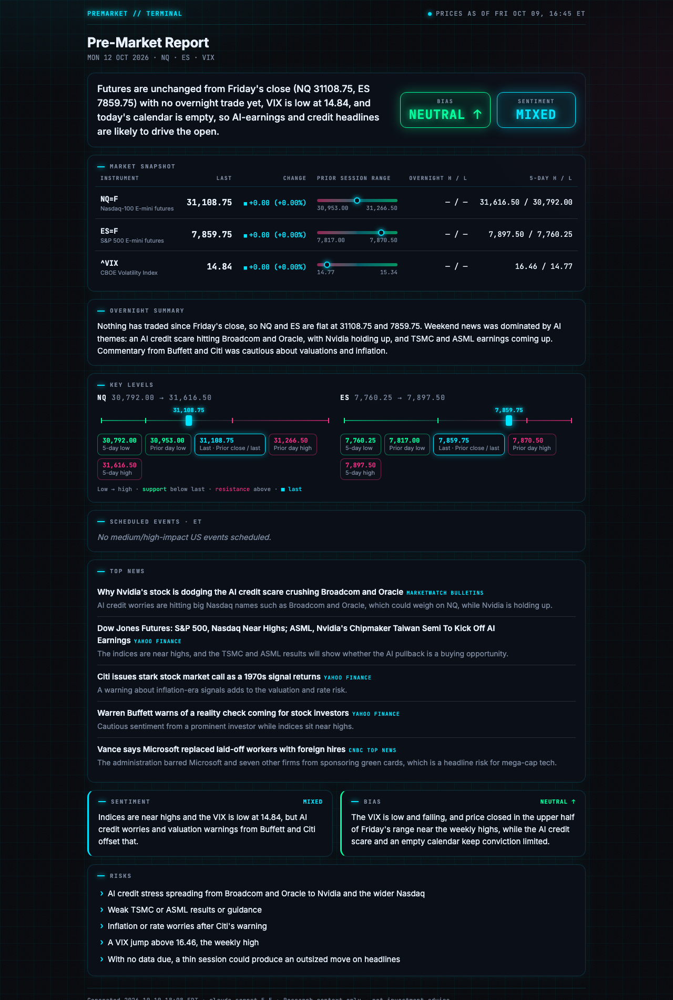
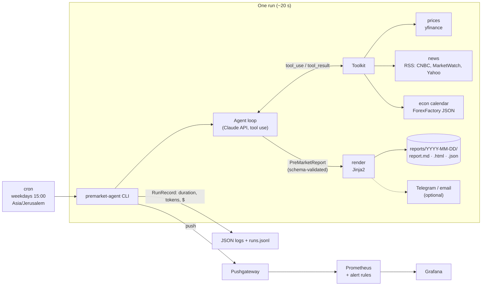
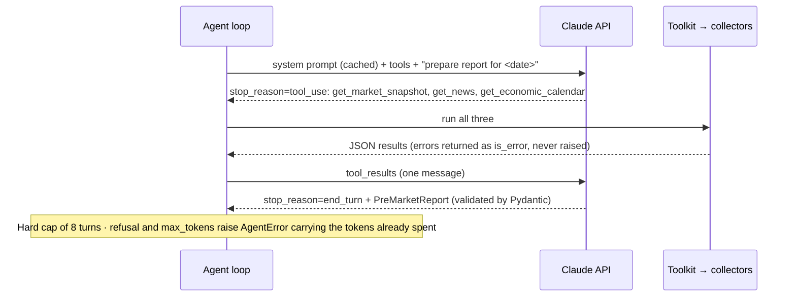
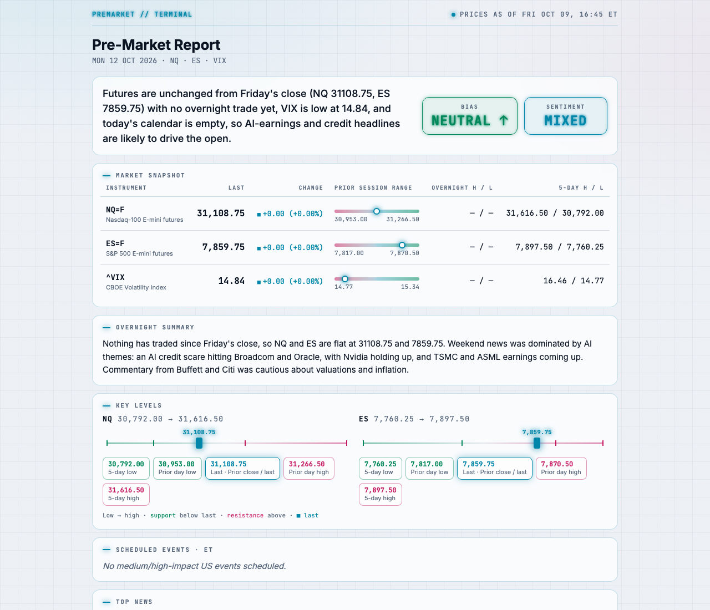
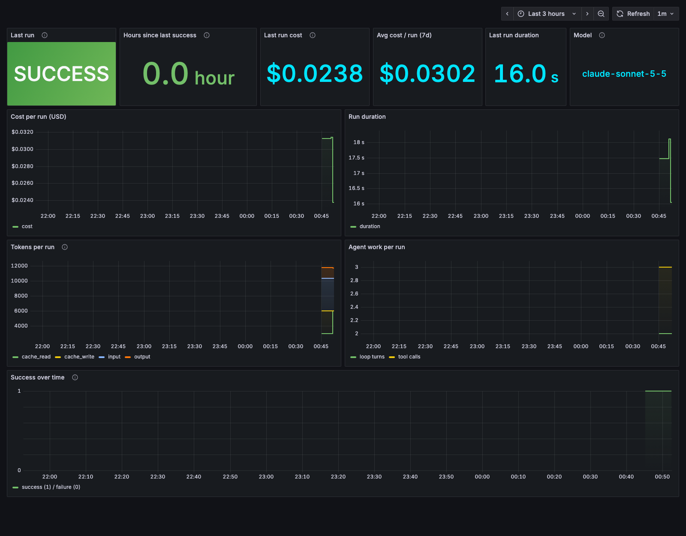

# Pre-Market AI Research Agent

[](https://github.com/yotamgillon/premarket-ai-agent/actions/workflows/ci.yml)


Every trading morning, an AI agent built on Claude gathers market context for **NQ and ES
futures** (prices, overnight action, news, the economic calendar) and writes a
concise **pre-market research report** in Markdown and HTML. Each run is logged with its
duration, token usage and **cost in dollars**, and exposed to Prometheus and Grafana.

One command runs the whole system locally: `make up`.

<p align="center">
  
</p>

> 📼 **Demo GIF:** _placeholder. Planned: `make up` → report opens → Grafana dashboard._

---

## Contents

- [The problem](#the-problem)
- [The solution](#the-solution)
- [What this is and isn't](#what-this-is-and-isnt)
- [Architecture](#architecture)
- [Example output](#example-output)
- [Quick start](#quick-start)
- [Tech stack](#tech-stack)
- [Design decisions](#design-decisions)
- [Cost per run](#cost-per-run)
- [Observability](#observability)
- [Testing & CI](#testing--ci)
- [Deployment](#deployment)
- [Limitations](#limitations)
- [Future work](#future-work)

## The problem

Before the US open, an intraday futures trader checks the same things every day: where
NQ and ES traded overnight, the prior session's high, low and close, the VIX, what's in
the news, and which economic releases are due. That means five browser tabs, about 20
minutes, and things get missed on busy mornings.

## The solution

A scheduled agent does the gathering and writes a two-minute briefing:

1. **Deterministic collectors** fetch prices (yfinance), headlines (RSS) and the US economic
   calendar (ForexFactory feed).
2. **A Claude agent** calls those collectors as **tools**, reasons over the results, and
   returns a report that the **API itself constrains to a typed schema**: TL;DR, overnight
   summary, key levels, scheduled events, top news, sentiment, a directional lean, risks
   and data gaps.
3. **Rendering** produces `reports/YYYY-MM-DD/report.{md,html,json}`. Telegram and email
   delivery are optional.
4. **Observability:** every run is logged as JSON, appended to a run history, and pushed
   to Prometheus via a Pushgateway. Grafana shows success, cost, tokens and latency.

## What this is and isn't

Being upfront about this matters more than the feature list.

- **It is a research summary, not a trading signal.** The report organizes public data
  and gives a *lean* (`bullish`, `neutral_up`, `neutral_down`, `bearish`). When the picture
  is mixed, the lean is a **close judgment call**. I've seen the same data produce
  `neutral_up` on one run and `neutral_down` on the next. Treat it as a prompt for your
  own analysis, never as a recommendation. Nothing here is investment advice.
- **The numbers come from data, not from the model.** The price table, the
  "prices as of" note and each instrument's position in its range are computed in Python.
  The model writes the narrative around them. (This was a deliberate fix: an early report
  claimed NQ was "in the upper half" of its range when it was at 49.6%.)
- **The AWS deployment was tested in simulation only.** The setup scripts pass
  `shellcheck`, `run.sh` was exercised in an Ubuntu 24.04 container (locking, logging,
  argument passing), and the full Docker stack runs locally. The step-by-step guide has
  **not yet been run end to end on a real EC2 instance.**
- **The committed example report was generated on a weekend with `--force`,** so it reflects
  Friday's close with no overnight session. It will be replaced with a live
  trading-morning report.

## Architecture



**The agent loop** is written by hand rather than using the SDK's beta tool runner, so that
token usage is counted on every turn and every stop reason is handled explicitly:



## Example output

- 📄 [`reports/2026-10-12/report.md`](reports/2026-10-12/report.md): readable directly on GitHub
- 🌐 [`reports/2026-10-12/report.html`](reports/2026-10-12/report.html): the HTML version (download and open it)
- 🧾 [`reports/2026-10-12/report.json`](reports/2026-10-12/report.json): the raw structured output

| Light theme | Grafana dashboard |
|---|---|
|  |  |

## Quick start

**Prerequisites:** [Docker Desktop](https://www.docker.com/products/docker-desktop/) and an
[Anthropic API key](https://console.anthropic.com/). For local development without Docker
you also need [uv](https://docs.astral.sh/uv/).

```bash
git clone https://github.com/yotamgillon/premarket-ai-agent.git
cd premarket-ai-agent
cp .env.example .env          # then set ANTHROPIC_API_KEY in .env

make up                       # build, start Prometheus/Pushgateway/Grafana, run the agent once
```

- The report appears in `reports/<today>/`. On weekends and NYSE holidays the agent
  skips the run; force one with `make report ARGS="--force"`.
- Grafana: <http://localhost:3000> (the dashboard opens by default). Prometheus: <http://localhost:9090>.

Other commands (`make help`):

| Command | What it does |
|---|---|
| `make report ARGS="--force --date 2026-10-12"` | Run the agent again |
| `make logs` | Follow the agent's JSON logs |
| `make test` / `make lint` | Tests (pytest) / lint and format check (ruff) |
| `make down` / `make clean` | Stop containers / also delete the metrics volumes |

**Without Docker:**

```bash
uv sync
uv run premarket-agent --force          # writes reports/<date>/
```

### Configuration (`.env`)

| Variable | Default | Purpose |
|---|---|---|
| `ANTHROPIC_API_KEY` | _(required)_ | Claude API key |
| `CLAUDE_MODEL` | `claude-opus-5-5` | Any model in the pricing table; I run `claude-sonnet-5-5` |
| `CLAUDE_EFFORT` | `medium` | `low` … `max`; trades depth of reasoning against tokens |
| `PUSHGATEWAY_URL` | _(empty = off)_ | Set automatically in Docker Compose |
| `TELEGRAM_BOT_TOKEN`, `TELEGRAM_CHAT_ID` | _(empty = off)_ | Send a summary and the HTML file to Telegram |
| `SMTP_HOST`, `SMTP_PORT`, `SMTP_USER`, `SMTP_PASSWORD`, `EMAIL_TO` | _(empty = off)_ | Email the HTML report |

## Tech stack

| Area | Choice |
|---|---|
| Language | Python 3.12, type hints throughout, `src/` layout |
| LLM | Claude API (Anthropic Python SDK): tool use, structured outputs, prompt caching |
| Data | yfinance · RSS via httpx + feedparser · ForexFactory calendar JSON · `holidays` (NYSE) |
| Validation & config | Pydantic v2, pydantic-settings (`.env`, `SecretStr`) |
| Rendering | Jinja2 (autoescaped HTML, `StrictUndefined`) |
| Packaging | uv with a lockfile |
| Quality | pytest (75 tests, 97% coverage), ruff (lint and format) |
| Containers | Multi-stage Dockerfile (non-root), Docker Compose |
| Observability | JSON logs, Prometheus + Pushgateway, Grafana (provisioned), alert rules |
| CI | GitHub Actions: lint, test, gitleaks secret scan, Docker build and smoke test |
| Deployment | AWS EC2 (Ubuntu 24.04), cron, SSH tunnel to Grafana |

## Design decisions

1. **Deterministic collectors, LLM only for synthesis.** Fetching and arithmetic are plain
   Python and unit-tested. Claude does what code can't: weighing headlines against price
   action and writing a briefing. Any number that matters is computed, not generated.
2. **Collectors exposed as tools.** The agent decides what to call; in practice it calls all
   three in parallel on the first turn. That keeps the door open for richer tools
   (for example news search by keyword) without rewriting the orchestration.
3. **The API enforces the output schema.** The final answer must match the `PreMarketReport`
   Pydantic model, so rendering is plain templating with no free-text parsing. Forcing a
   "submit_report" tool call isn't an option, because current models reject forced
   `tool_choice`. The schema also enforces product rules: a plain `"neutral"` bias is invalid.
4. **A hand-written agent loop** with an 8-turn cap, explicit handling of `tool_use`,
   `refusal` and `max_tokens`, and per-turn token accounting. Tool failures go back to the
   model as `is_error` results, so one dead RSS feed produces a report that says what's
   missing instead of no report at all.
5. **Prompt caching on the static prefix.** The system prompt and tool definitions never change
   (the date lives in the user message), so turn 2 reads them from cache.
6. **Pushgateway, because this is a batch job.** Prometheus pulls metrics, but a process that
   lives for 20 seconds has nothing to pull. It pushes its final metrics with `pushadd`
   (POST), so a failed run doesn't overwrite `last_success_timestamp`. That's what makes
   the "no successful run in 26h" alert work.
7. **Failure is observable, and failed runs still count their cost.** A run that fails on
   turn 3 has still been billed for three turns. `AgentError` carries the token usage up to
   the failure, so cost metrics include failed runs.
8. **Delivery and monitoring never fail the job.** If Telegram, SMTP or the Pushgateway is
   down, that's logged, and the report is still written.
9. **Security by default:** secrets only in `.env` (git-ignored, `SecretStr`, never logged),
   a gitleaks scan in CI, a non-root container, monitoring ports bound to `127.0.0.1`,
   HTML autoescaping for untrusted headlines, and a read-only deploy key on the server.
10. **Timezones:** all market logic runs in New York time. The server's cron runs in
    `Asia/Jerusalem`, so "15:00" stays correct through both countries' daylight-saving changes,
    which happen on different dates.

## Cost per run

Measured over 6 runs on **Claude Sonnet 5.5** (`effort=medium`), each with 2 turns and
3 tool calls:

| | Tokens per run | Price (per 1M tokens) | Cost |
|---|---:|---:|---:|
| Input (uncached) | ~4,370 | $2.00 | $0.0087 |
| Output | ~1,450 | $10.00 | $0.0145 |
| Cache write (system prompt + tools) | ~3,000 | $2.50 | $0.0075 |
| Cache read (turn 2) | ~3,000 | $0.20 | $0.0006 |
| **Total** | | | **≈ $0.031** |

- **Measured:** median **$0.031** (range $0.024–$0.032), **16–23 s** per run.
- **Per month** (about 21 trading days): **≈ $0.65**.
- **Claude Opus 5.5** with the same token counts would be about **$0.06 per run**. That's an
  estimate, not a measurement.
- Daily runs are 24 hours apart and the cache lasts 5 minutes, so every production run pays
  one cache write. Caching still pays off *within* a run.

Cost is calculated in [`observability/cost.py`](src/premarket_agent/observability/cost.py)
from the API's `usage` fields, and exported as `premarket_run_cost_usd`.

## Observability

| Signal | Where |
|---|---|
| JSON logs, one object per line | stdout → `docker compose logs agent`, or `logs/agent-YYYY-MM.log` on EC2 |
| Run history | `reports/runs.jsonl` (status, duration, tokens, cost, error) |
| Metrics | `premarket_run_success`, `_duration_seconds`, `_cost_usd`, `_tokens{type}`, `_iterations`, `_tool_calls`, `last_success_timestamp_seconds`, `_info{model,status}` |
| Alerts ([`alerts.yml`](deploy/prometheus/alerts.yml)) | no success in 26h · last run failed · unusually high cost |
| Dashboard | [`deploy/grafana/dashboards/premarket.json`](deploy/grafana/dashboards/premarket.json), loaded automatically |

## Testing & CI

- **75 tests, 97% coverage, and no network access.** Claude is replaced by a scripted fake
  client, HTTP by `httpx.MockTransport`, yfinance by a fake `Ticker`, and SMTP by a fake class.
  CI needs no secrets.
- Tests cover the awkward cases on purpose: the Monday overnight window that spans the
  weekend, refusals, `max_tokens`, runaway tool loops, a dead feed, duplicate headlines,
  XSS in a headline, prices outside the prior range, and secrets never appearing in logs.
- **GitHub Actions** on every push: ruff lint and format check → pytest with coverage →
  gitleaks over the full git history → Docker build (with layer cache), plus a smoke test
  that checks the image runs as non-root.

## Deployment

See **[docs/DEPLOY_AWS.md](docs/DEPLOY_AWS.md)** for running on an EC2 free-tier instance
with a weekday cron at 15:00 Israel time. The guide covers a budget alert, an SSH-only
security group, a read-only GitHub deploy key, Grafana through an SSH tunnel,
troubleshooting and teardown.

> **Status: tested in simulation only.** See [What this is and isn't](#what-this-is-and-isnt).

## Limitations

- **The data sources are free and unofficial.** yfinance scrapes Yahoo, and the ForexFactory
  JSON feed isn't a supported API. Either can change or rate-limit without notice. The agent
  degrades gracefully (it reports a data gap), but a production system would use a paid feed.
- **The LLM's judgment is not deterministic.** Wording and, on close calls, the lean can
  differ between runs on the same data. There's no automated evaluation of report quality yet.
- **The 26-hour alert fires every Monday** after a weekend with no runs. That's correct but noisy.
- **The image is about 560 MB,** mostly pandas, numpy and curl_cffi pulled in by yfinance.
- **Single instance, no high availability.** If the EC2 host is down at 15:00, that day's report is missed.

## Future work

- **Evals for factual accuracy:** automatically check that every price cited in the
  narrative exists in the tool output, and that range descriptions match `range_position_pct`.
- Make the staleness alert trading-day aware (or switch to a dead-man's-switch heartbeat).
- Build and push the image to GHCR in CI, so the server only pulls and never builds.
- Secrets from AWS SSM Parameter Store via an IAM instance role, so there's no `.env` on disk.
- Infrastructure as code (Terraform) for the EC2 instance, security group and budget.
- A slimmer image: replace yfinance and pandas with a small HTTP client.
- Publish a report archive to GitHub Pages, and compare models and effort levels on cost vs. quality.
- Record the demo GIF.

---

<sub>Built as a portfolio project. Market data © its respective providers. Research context only, not investment advice.</sub>
