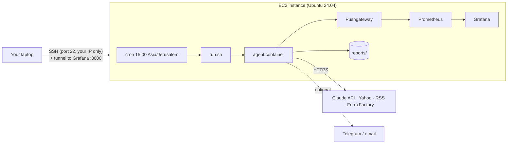

# Deploying to AWS EC2

This guide runs the agent on a small EC2 instance that writes a report every weekday at
**15:00 Israel time** (about 90 minutes before the US cash open). The whole Docker stack
runs on the instance: agent, Pushgateway, Prometheus and Grafana.



**Time:** about 30 minutes. **Cost:** free inside the AWS Free Tier, otherwise about
$8–10 a month for the instance plus about $0.03 per report for the Claude API (see [Costs](#costs)).

---

## 0. Before you start

- An AWS account (you need a credit card even for the free tier).
- Your Anthropic API key.
- This repository on GitHub (private is fine).

## 1. Set a budget alert first

Do this before creating anything. It's the single best protection against a surprise bill.

1. AWS Console → **Billing and Cost Management → Budgets → Create budget**.
2. Choose **Use a template → Zero spend budget** (or a monthly budget of $5).
3. Enter your email and create it.

You'll get an email as soon as anything starts costing money.

## 2. Create an SSH key pair

AWS Console → **EC2 → Key pairs → Create key pair**:
- Name: `premarket-agent`
- Type: **ED25519**, format **.pem**

The `.pem` file downloads once. Move it somewhere safe and restrict its permissions:

```bash
mv ~/Downloads/premarket-agent.pem ~/.ssh/
chmod 400 ~/.ssh/premarket-agent.pem
```

## 3. Launch the instance

**EC2 → Instances → Launch instance:**

| Setting | Value | Why |
|---|---|---|
| Name | `premarket-agent` | |
| AMI | **Ubuntu Server 24.04 LTS** (x86_64) | LTS = security updates until 2029 |
| Instance type | the one labelled **Free tier eligible** (usually `t3.micro`) | 2 vCPU, 1 GB RAM is enough with swap |
| Key pair | `premarket-agent` | |
| Network → Security group | create new, **allow SSH from My IP** only | nothing else is exposed |
| Storage | **20 GiB gp3** | Docker images ~1.5 GB plus metrics history |

Under **Advanced details**, leave everything else as default. Click **Launch**.

> **Don't open ports 3000, 9090 or 9091 to the internet.** Grafana, Prometheus and the
> Pushgateway are bound to `127.0.0.1` in `docker-compose.yml` and you reach them
> through an SSH tunnel (step 9). An open Pushgateway would let anyone write fake metrics.

Optional but recommended: **EC2 → Elastic IPs → Allocate**, then associate it with the
instance, so the address doesn't change after a stop/start. (It's free while attached to
a running instance.)

## 4. Connect

Copy the instance's **Public IPv4 address** from the console:

```bash
ssh -i ~/.ssh/premarket-agent.pem ubuntu@<PUBLIC_IP>
```

Tip: add this to `~/.ssh/config` on your laptop so later commands are just `ssh premarket`:

```
Host premarket
    HostName <PUBLIC_IP>
    User ubuntu
    IdentityFile ~/.ssh/premarket-agent.pem
```

## 5. Get the code onto the instance (read-only deploy key)

The repo is private, so the instance needs credentials. Use a **deploy key**: an SSH key
that can only *read* this one repository. If the instance were ever compromised, the
attacker couldn't push code or touch your other repos.

On the instance:

```bash
ssh-keygen -t ed25519 -N "" -f ~/.ssh/github_deploy -C "premarket-ec2"
cat ~/.ssh/github_deploy.pub
cat >> ~/.ssh/config <<'EOF'
Host github.com
    IdentityFile ~/.ssh/github_deploy
    IdentitiesOnly yes
EOF
```

On GitHub: **repo → Settings → Deploy keys → Add deploy key**, paste the public key, and
leave **Allow write access unchecked**.

Back on the instance:

```bash
sudo mkdir -p /opt/premarket-ai-agent && sudo chown ubuntu:ubuntu /opt/premarket-ai-agent
git clone git@github.com:<your-github-user>/premarket-ai-agent.git /opt/premarket-ai-agent
```

## 6. Run the setup script

```bash
cd /opt/premarket-ai-agent
bash deploy/ec2/setup.sh
```

What it does (it's safe to run again):

1. Sets the system timezone to `Asia/Jerusalem`.
2. Adds 2 GB of swap, because 1 GB of RAM is tight for building the image plus Grafana and Prometheus.
3. Installs Docker Engine and the Compose plugin from Docker's official apt repository.
4. Turns on automatic security updates (`unattended-upgrades`).
5. Creates `.env` from `.env.example` with `chmod 600`.
6. Installs the crontab from `deploy/ec2/crontab`.

**Log out and back in** so your user's new `docker` group membership applies.

## 7. Configure secrets

```bash
cd /opt/premarket-ai-agent
nano .env
```

Set at least `ANTHROPIC_API_KEY=...`. Optional: `TELEGRAM_BOT_TOKEN` and
`TELEGRAM_CHAT_ID` to get each report on your phone. That's the easiest way to read
reports produced on a server.

`.env` is readable only by your user (`chmod 600`) and is never committed. For a
production setup, the next step up is AWS SSM Parameter Store or Secrets Manager with an
IAM instance role, which means no secrets on disk at all (see README, *Future work*).

## 8. First run

```bash
make up                                   # build the image, start monitoring, run once
make report ARGS="--force"                # on a weekend/holiday, force a run to test
ls reports/                               # the report folder appears here
tail -n 5 logs/*.log 2>/dev/null; docker compose logs agent | tail -n 5
```

The first `make up` builds the image on the instance. That takes a few minutes on a
micro instance, which is why the swap is there.

## 9. Open Grafana through an SSH tunnel

From your laptop:

```bash
ssh -N -L 3000:localhost:3000 -L 9090:localhost:9090 premarket
```

Then open <http://localhost:3000> in your browser. The tunnel forwards your laptop's port 3000 over
the encrypted SSH connection to Grafana on the instance. Nothing new is exposed publicly.
Press Ctrl+C to close the tunnel.

## 10. Verify the schedule

```bash
timedatectl | grep "Time zone"     # Asia/Jerusalem
crontab -l                         # 0 15 * * 1-5 .../deploy/ec2/run.sh
```

**Why set the system timezone instead of writing the cron line in UTC?** Israel and the
US switch daylight saving time on different dates, and a UTC line would drift by an hour
for part of the year. With the system clock on `Asia/Jerusalem`, `0 15 * * 1-5` means
15:00 Israel time all year round. Cron runs Monday to Friday, and the agent itself skips
NYSE holidays.

> Note: because the clocks change on different dates, 15:00 Israel time is usually
> 08:00 New York time, but it's 07:00 or 09:00 ET for a few weeks each spring and autumn.
> To pin the run to New York time instead, set `TIMEZONE=America/New_York` when running
> `setup.sh` and change the cron line to `0 8 * * 1-5`.

To test the cron path without waiting, run exactly what cron runs:

```bash
/opt/premarket-ai-agent/deploy/ec2/run.sh --force
tail -n 3 /opt/premarket-ai-agent/logs/agent-$(date +%Y-%m).log
```

`run.sh` uses `flock`, so two runs can never overlap, and appends to a monthly log file.

## Updating

```bash
cd /opt/premarket-ai-agent
git pull
docker compose build agent          # rebuild with the new code
docker compose up -d                # restart monitoring if its config changed
```

## Troubleshooting

| Symptom | Check |
|---|---|
| `permission denied ... docker.sock` | You didn't log out and back in after `setup.sh` |
| No report at 15:00 | `grep CRON /var/log/syslog \| tail`; `tail logs/agent-*.log` |
| `ANTHROPIC_API_KEY is not set` | `.env` is in `/opt/premarket-ai-agent`, with no quotes or spaces around `=` |
| Build killed / very slow | `free -h`: is swap on? (`swapon --show`) |
| Grafana tunnel fails | Is the stack up? `docker compose ps`. Is local port 3000 already in use? |
| Disk filling up | `docker system df`; logs are capped at 3×10 MB per container |
| Alert "no success in 26h" on Monday | Expected after a weekend; see README *Future work* |

## Costs

| Item | Free tier | After free tier (approx.) |
|---|---|---|
| EC2 `t3.micro` (24/7) | Covered for eligible accounts | ~$7.50/month |
| EBS 20 GiB gp3 | 30 GiB covered | ~$1.60/month |
| Elastic IP (attached) | Free while the instance runs | $3.60/month if left unattached |
| Data transfer | Negligible | Negligible |
| Claude API (Sonnet 5.5, ~21 runs) | — | ~$0.65/month |

AWS free-tier terms differ by account age. Accounts created after mid-2025 get credits
instead of 12 free months. Check **Billing → Free Tier** for your account, and rely on the
budget alert from step 1.

## Tearing down

When you no longer need it: **EC2 → Instances → Terminate**, then release the Elastic IP
(**Elastic IPs → Release**) and delete the volume if it wasn't deleted with the instance.
Delete the deploy key on GitHub as well.

## Security summary

- Only port 22 is open, and only to your IP. Monitoring is reached through an SSH tunnel.
- The GitHub access is a read-only deploy key scoped to this one repository.
- Secrets live in a `chmod 600` `.env`, never in git, and are scanned for in CI by gitleaks.
- The agent container runs as a non-root user. Monitoring ports are bound to `127.0.0.1`.
- Automatic OS security updates are on, and all container images are pinned versions.
